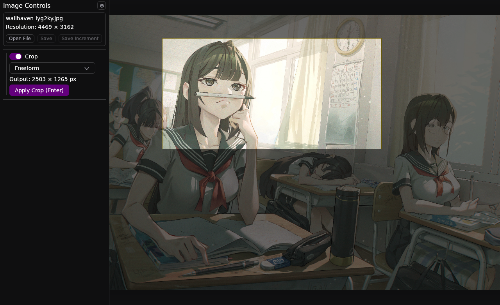

# Croppers
Gpu accelerated image viewer with streamlined cropping workflow and some fun image filters.


### Install
have [just](https://github.com/casey/just) and [rust](https://rust-lang.org/learn/get-started/) installed and run
```bash
just install
```
or look at the justfile and place the files there yourself.
Only tested and developed on arch/wayland/niri.

## Features

### different cropping modes
original and cropped version live side by side. That makes adjustments to the crop easy. Just toggling crop on again ('c') and the original image is shown.

#### Freeform Crop


#### Crop to desired output dimensions
a crop with integrated scaling


#### Various fixed aspect ratios and scaling


### Effect Stack
A gpu accelerated effect stack with some fun effects.

vignette


stacking effects with drag and drop reordering


### Settings for working fast

<table>
  <tr>
    <td width="70%" valign="top">
      <p>
          Set what the options for new images should be depending on the task currently desired.
      </p>
      <ul>
        <li>Fast setup</li>
        <li>Zero dependencies</li>
      </ul>
    </td>
    <td width="30%" align="center" valign="top">
      
    </td>
  </tr>
</table>
